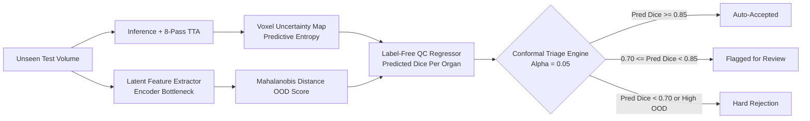

# CrossScan: Master Engineering & Research Execution Plan

> **System Objective**: Build a unified 3D semantic segmentation system capable of generalising across both Computed Tomography (CT) and Magnetic Resonance Imaging (MRI) unseen scanners, vendors, and pulse sequences, equipped with an intrinsic self-audit layer that detects its own segmentation failures without ground-truth annotations.

---

## 1. System Architecture & Core Innovations

```mermaid
flowchart TD
    subgraph Data Harmonization Layer
        A1[Multi-Site CT Volumes<br/>AMOS, TotalSegmentator CT] --> B[Ontology Harmonizer<br/>8-Organ Shared Space]
        A2[Multi-Sequence MRI Volumes<br/>AMOS, TotalSegmentator MRI, CHAOS] --> B
        B --> C1[CT Pipeline: HU Windowing<br/>[-160, 240] HU]
        B --> C2[MRI Pipeline: N4ITK Bias-Correction<br/>Percentile Clip + Z-Score]
        C1 --> D[Canonical Resampling<br/>1.5x1.5x1.5mm RAS+]
        C2 --> D
    end

    subgraph Model Arms Benchmark
        D --> M1[Arm 1: nnU-Net v2 Baseline<br/>Residual Encoder, Per-Modality]
        D --> M2[Arm 2: Modality-Agnostic Joint UNet<br/>Domain Randomization SynthSeg-style]
        D --> M3[Arm 3: Foundation Model Adaptation<br/>VISTA3D / MedSAM2 + 3D LoRA]
        D --> M4[Arm 4: CT-to-MRI Cross-Translation<br/>3D CycleGAN with Hallucination Audit]
    end

    subgraph Robustness Stress Suite
        M1 & M2 & M3 & M4 --> R1[Natural Shifts: LOSO<br/>Vendor GE/Siemens/Philips, 1.5T vs 3T, Phases]
        M1 & M2 & M3 & M4 --> R2[Synthetic Shifts<br/>Motion, Ghosting, Rician Noise, Thick Slices]
    end

    subgraph Reliability & Failure Prediction
        M2 --> U[Uncertainty Engine<br/>Monte-Carlo TTA + Voxel Entropy]
        M2 --> S[OOD Latent Shift Detector<br/>Mahalanobis / Bottleneck Energy]
        U & S --> QC[Label-Free QC Regressor<br/>Predicts Case & Organ Dice w/o GT]
        QC --> CRC[Conformal Risk Control Engine<br/>Statistically Guaranteed Error Rate]
        CRC --> T1[Green: Auto-Accept]
        CRC --> T2[Yellow: Flag for Radiologist Review]
        CRC --> T3[Red: Reject / Rescan Trigger]
    end

    subgraph Clinical Deployment
        T1 & T2 --> DEP[DICOM-SEG Exporter<br/>highdicom + SNOMED CT Ontology]
        DEP --> ORTH[Orthanc DICOMweb Server]
        ORTH --> SLICER[3D Slicer / OHIF Viewer]
    end
```

---

## 2. Dataset Strategy & Harmonization Protocol

### 2.1 Core Datasets
1. **AMOS22 (Multi-Modality Abdominal Multi-Organ Segmentation)**:
   - 500 CT scans and 100 MRI scans with 15 abdominal organs annotated from multiple clinical sites.
   - Primary source for cross-modality joint representation.
2. **TotalSegmentator (CT v2 & MRI)**:
   - 1,204 CT scans (117 anatomical classes) + TotalSegmentator MRI (1,000+ volumes).
   - High-volume pretraining and domain diversity across pathologies and body shapes.
3. **External Generalization Benchmarks**:
   - **CHAOS ISBI 2019 Challenge**: Held-out abdominal CT and multi-sequence MRI (T1-DUAL in-phase/out-phase, T2-SPIR).
   - **External Site Hold-Out**: An entire scanner manufacturer (e.g. all Philips MRI scans) completely withheld from training and validation to measure true zero-shot cross-vendor transfer.

### 2.2 Shared Anatomical Ontology (8 Core Structures)
To reconcile annotation variances and keep training tractable without compromising clinical depth:
1. **Liver** (RadLex: RID58, SNOMED: 10200004)
2. **Spleen** (RadLex: RID86, SNOMED: 78961009)
3. **Right Kidney** (RadLex: RID205, SNOMED: 24964005)
4. **Left Kidney** (RadLex: RID206, SNOMED: 18639004)
5. **Pancreas** (RadLex: RID170, SNOMED: 15776009)
6. **Stomach** (RadLex: RID80, SNOMED: 34516001)
7. **Abdominal Aorta** (RadLex: RID1001, SNOMED: 281130003)
8. **Inferior Vena Cava (IVC)** (RadLex: RID1220, SNOMED: 64131007)

### 2.3 Partial Labeling & Loss Formulation
Different public datasets omit certain organs. Standard Cross-Entropy penalizes unannotated organs as background, causing gradient corruption.
CrossScan implements a **Masked Margin Loss**:
$$\mathcal{L}_{\text{total}} = \mathcal{L}_{\text{Masked-Dice}} + \mathcal{L}_{\text{Masked-CE}}$$
$$\mathcal{L}_{\text{Masked-Dice}} = 1 - \frac{1}{|\mathcal{C}_{\text{present}}|} \sum_{c \in \mathcal{C}_{\text{present}}} \frac{2 \sum_i p_{i, c} y_{i, c} + \epsilon}{\sum_i p_{i, c}^2 + \sum_i y_{i, c}^2 + \epsilon}$$
where $\mathcal{C}_{\text{present}}$ is the indicator set of organs verified present in the dataset metadata, preventing unannotated structures from being treated as true negatives.

---

## 3. Four-Arm Model Benchmark

| Arm | Architecture | Training Paradigm | Role in Study |
|---|---|---|---|
| **Arm 1: nnU-Net v2 (Gold Standard Baseline)** | 3D Fullres Residual Encoder UNet | Modality-specific (one trained solely on CT, one on MRI) | Ground truth reference; establishes upper-bound single-modality ceiling |
| **Arm 2: Modality-Agnostic Joint UNet** | 3D ResUNet / SwinUNETR | Unified joint training with aggressive domain randomization (SynthSeg style) | Primary novel architecture: one model for both modalities |
| **Arm 3: Foundation Model Adaptation** | VISTA3D / MedSAM2 / SAM-Med3D | Frozen visual backbone + 3D LoRA (rank 16) bottleneck adapter | State-of-the-art transfer efficiency & interactive promptability |
| **Arm 4: Cross-Modality Translation** | 3D CycleGAN / Diffusion Bridge | Translate CT $\to$ pseudo-MRI to train MRI model with CT labels | Evaluates data-space vs feature-space cross-modality synthesis |

---

## 4. Robustness Suite: Natural & Synthetic Stress-Testing

### 4.1 Natural Domain Shifts
- **Scanner Vendors**: Siemens Magnetom vs GE Signa vs Philips Achieva.
- **Magnetic Field Strengths**: 1.5 Tesla vs 3.0 Tesla signal-to-noise and chemical shift behavior.
- **MRI Pulse Sequences**: T1-weighted (in-phase, out-of-phase), T2-weighted, Contrast-Enhanced T1 (arterial, portal venous, equilibrium).
- **CT Protocols**: Low-dose vs standard-dose; sharp bone kernels vs smooth soft-tissue kernels.

### 4.2 Synthetic Perturbations (Physics-Informed)
- **k-Space Ghosting & Motion**: Phase-encoding discrete artifact injection simulating patient breathing.
- **Rician & Gaussian Noise**: Noise injection scaled to clinical SNR levels (5dB - 25dB).
- **Severe B1 Inhomogeneity**: Spatially varying polynomial bias fields.
- **Slice Thickness Degradation**: Resampling axial thickness from 1.5mm to 5.0mm and 7.5mm with nearest/linear downsampling.

---

## 5. Reliability & Self-Auditing Layer (Key Differentiator)



### 5.1 Uncertainty Quantification
- **Monte-Carlo Test-Time Augmentation (TTA)**: 8-pass spatial flips and scaling.
- **Predictive Voxel Entropy**:
  $$H(x) = - \sum_{c=1}^C \bar{p}_c(x) \log \bar{p}_c(x)$$
- Extract per-organ boundary uncertainty by computing the integral of entropy within the 3mm boundary dilation of predicted masks.

### 5.2 Label-Free Quality Control (QC)
- A lightweight gradient-boosted or multi-layer perceptron regressor that takes:
  1. Volume-level image statistics (signal-to-noise ratio, sharpness, entropy).
  2. Prediction morphology (predicted volume, surface-to-volume ratio, Euler characteristic / topological holes).
  3. Prediction confidence (mean foreground probability, boundary entropy).
  4. Bottleneck latent distance from training cluster centroids.
- Output: Predicted Dice $\hat{D}_c$ for each organ without knowing the ground truth.

### 5.3 Conformal Risk Control (CRC) Triage
Using split conformal prediction, we determine an empirical acceptance threshold $\hat{\lambda}$ on calibration data such that:
$$\mathbb{E}[L(\text{Accepted})] \le \alpha \quad (\text{e.g. Risk } \le 5\% \text{ error})$$
This yields a mathematically rigorous **Risk-Coverage Curve**:
- Showing the trade-off: e.g., "At 75% coverage, the automated model achieves 0.91 mean Dice, while routing the difficult 25% of cases to radiologist review."

---

## 6. Clinical Deployment & Standards Compliance

1. **Standard DICOM-SEG (SOP Class 1.2.840.10008.5.1.4.1.1.66.4)**:
   - Export multi-frame binary segments preserving DICOM `FrameOfReferenceUID`, `PatientID`, `StudyInstanceUID`.
   - Coded anatomy labels using SNOMED CT and RadLex standard code sequences.
2. **Orthanc & DICOMweb Connectivity**:
   - `STOW-RS` endpoint to upload DICOM-SEG masks back to Orthanc PACS server.
   - `WADO-RS` / `QIDO-RS` endpoints to query and retrieve series dynamically.
3. **3D Slicer / OHIF Compatibility**:
   - Real-time visualization of predicted masks overlaid on source DICOM volumes with error heatmap visualization.
4. **Latency & Compute Profiling**:
   - Mixed precision (FP16 / BF16) sliding-window inference with MONAI.
   - ONNX Runtime and TensorRT export scripts for production throughput benchmarking.

---

## 7. Phased 12-Week Production Roadmap

### Phase 1: Environment, Harmonization & Baseline Sanity (Weeks 1-2)
- [x] Hardware and toolchain configuration (CUDA, PyTorch, MONAI, SimpleITK, HighDICOM).
- [ ] Universal ontology and metadata mapper (AMOS, TotalSegmentator, CHAOS $\to$ 8 classes).
- [ ] Preprocessing and canonicalization engine (RAS+ reorientation, spacing resampling, HU windowing, N4 bias field).
- [ ] Automated download and integrity verification scripts for AMOS22, TotalSegmentator, and CHAOS.
- [ ] Zero-shot TotalSegmentator sanity check pipeline on sample CT and MRI.

### Phase 2: Per-Modality Baselines & Modality-Agnostic Model (Weeks 3-4)
- [ ] Baseline nnU-Net v2 3D residual encoder architecture and training loop.
- [ ] Modality-Agnostic Joint UNet architecture with masked margin loss.
- [ ] Realistic domain randomization module (SynthSeg-style contrast, noise, bias field, blur).
- [ ] Training execution on harmonized CT + MRI dataset.

### Phase 3: Foundation Model Adaptation & Translation Arm (Weeks 5-6)
- [ ] VISTA3D / MedSAM2 3D LoRA parameter-efficient adaptation pipeline.
- [ ] Interactive click-simulation module measuring clicks-to-target-Dice ($DSC \ge 0.85$).
- [ ] 3D CT-to-MRI synthesis pipeline with anatomical structural consistency / hallucination audit.

### Phase 4: Robustness Stress-Testing Suite (Weeks 7-8)
- [ ] Leave-One-Site-Out (LOSO) and Leave-One-Sequence-Out evaluation benchmarks.
- [ ] Synthetic artifact benchmark (k-space motion, ghosting, B1 bias, downsampled slice thickness).
- [ ] Metrics Reloaded evaluation framework: Dice, Normalized Surface Distance (NSD), HD95 with patient-level bootstrap CI (B=1000).
- [ ] Automated data contamination audit against foundation model training registries.

### Phase 5: Reliability, Label-Free QC & Conformal Triage (Week 9)
- [ ] Test-time augmentation (TTA) and voxel entropy calculation engine.
- [ ] Latent-space OOD detector (Mahalanobis / Energy score).
- [ ] Label-free QC regressor training for ground-truth-free Dice estimation.
- [ ] Conformal Risk Control (CRC) calibration for automated triage (Auto-Accept / Flag / Reject).
- [ ] Risk-Coverage curve generation.

### Phase 6: Clinical DICOM Packaging & Documentation (Weeks 10-12)
- [ ] DICOM in $\to$ DICOM-SEG out conversion pipeline with SNOMED CT terminology.
- [ ] Orthanc DICOMweb integration testbed.
- [ ] Throughput, memory, and latency profiling (FP16 vs FP32 vs ONNX).
- [ ] Complete documentation, failure taxonomy gallery, model cards, and portfolio demo.
